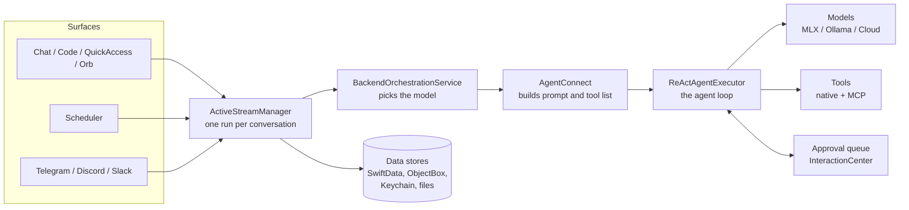

# Devgentic — Architecture

A short tour of how Devgentic is built, for anyone reading the code for the first time.
The [README](README.md) explains what the app does; this document explains how it fits together.

Related documents: [SECURITY.md](SECURITY.md) (trust model, reporting a vulnerability) ·
[PRIVACY.md](PRIVACY.md) (what data goes where) · [CONTRIBUTING.md](CONTRIBUTING.md) (building and conventions).

<!-- Maintenance note: this file deliberately cites file and type names, not line numbers, so it
     does not go stale on every edit. Re-check names when you move or rename things. -->

---

## 1. The big picture

Devgentic is a native macOS app for building and running AI agents.

You create **profiles**. A profile is a model plus the tools, settings and instructions it should use.
You then run a profile on one of several **surfaces**:

- a **chat** window
- a **workflow** canvas, where steps are wired together as a graph
- a **Code** workspace scoped to a project folder
- a global-hotkey **QuickAccess** panel
- a floating voice **Orb**
- a **scheduler** for unattended runs
- **remote chat bridges** (Telegram, Discord, Slack) that let you drive the app from your phone

The model can run **locally** (MLX on Apple Silicon, or an Ollama server) or in the **cloud**
(OpenAI, Anthropic, Google, OpenRouter, or any OpenAI-compatible endpoint). Agents act through
**tools**: built-in macOS capabilities such as files, shell, git and calendar, plus anything a
connected [MCP](https://modelcontextprotocol.io) server offers.

### What it deliberately is not

- **Not sandboxed.** The app exists to run commands, edit files and automate the Mac with *your*
  privileges, which the App Sandbox does not allow. So it is distributed as a Developer ID–signed,
  notarized download from GitHub, not through the App Store.
- **Not a service.** There is no Devgentic server, no account and no telemetry. Your conversations,
  files and keys stay on your Mac. The one exception is a cloud model: sending your request to that
  provider is what choosing it means (see [PRIVACY.md](PRIVACY.md)).
- **Not multi-user.** Remote control through chat assumes one operator: the account that paired
  with the Mac.

## 2. Technology

| | |
|---|---|
| Language / UI | Swift with strict concurrency checking; SwiftUI, with AppKit where SwiftUI falls short |
| Platform | macOS 26.1 or later, Apple Silicon only (arm64) |
| Local AI | [mlx-swift](https://github.com/ml-explore/mlx-swift) and [mlx-swift-lm](https://github.com/ml-explore/mlx-swift-lm); [WhisperKit](https://github.com/argmaxinc/WhisperKit) for speech-to-text |
| Cloud AI | Direct HTTPS to each provider |
| Tool protocol | MCP [swift-sdk](https://github.com/modelcontextprotocol/swift-sdk) |
| Storage | SwiftData (main store), ObjectBox (search index), GRDB/SQLite (traces), Keychain (secrets) |
| Updates | [Sparkle](https://github.com/sparkle-project/Sparkle) with signed updates |

Dependencies come from Swift Package Manager; exact versions are pinned in `Package.resolved` and
their licences are listed in [THIRD_PARTY_NOTICES.md](THIRD_PARTY_NOTICES.md).

## 3. Where things live

| Folder | What it holds |
|---|---|
| `Devgentic/Core/Backends/` | Everything that talks to a model. `TextGen/ReAct/` is the agent loop, `WorkflowGen/` is the workflow engine, `ImageGen/` is image generation. |
| `Devgentic/Core/Persistence/` | The database schema, the document search (RAG) stack, and key storage. |
| `Devgentic/Core/Utils/` | Shared runtime machinery: the stream manager, the approval queue, time-limit handling, history formatting. |
| `Devgentic/Core/Service/`, `Skills/`, `Storage/`, `Updates/` | The task scheduler, the skills library, media files, and the updater. |
| `Devgentic/Interfaces/` | All SwiftUI screens: `Main/` (window, sidebar, profile editor, workflow canvas, tool library, settings), `Shared/` (chat timeline and composer), `Code/`, `QuickAccess/`, `Onboarding/`, `CommandPalette/`. Native tool implementations are in `Main/Views/Tooling/Local/`. |
| `Devgentic/ChatOps/` | The Telegram, Discord and Slack bridges. |
| `Devgentic/Orb/` | The voice orb: wake word, speech in and out. |
| `Devgentic/Intelligence/` | Model-capability analysis and routing. |
| `Devgentic/Observaliblity/` | Tracing and diagnostics. (Yes, the folder name has a typo; the code uses it consistently.) |
| `Devgentic/Services/`, `Utilities/`, `Resources/` | Administrator-privilege command execution (via AppleScript), small shared helpers, and bundled assets (embedding model, model price list). |
| `DevgenticTests/` | Unit tests, including "drift" tests that read the source and fail if a design rule is broken. |
| `generated/` | Committed ObjectBox generated code (there is no build step for it; see the README). |
| `scripts/` | Release signing and verification scripts. |

## 4. How a request flows

Every surface sends its work to the same place. A profile's model runs with its tools, and anything
worth keeping lands in one of four stores.



## 5. Key flows

### 5.1 A chat turn

1. The composer hands the message to `ActiveStreamManager`, which allows **one run per conversation**.
   If you send a second message while one is running, it waits its turn and the screen says so.
   A second message arriving from a chat bridge is refused with an explanation instead, because a
   queued remote message could leave the sender waiting on an answer that never comes.
2. The stream manager saves your message and rebuilds the conversation history **from the database**,
   never from what is on screen. `BackendOrchestrationService` then picks the model's provider and
   checks the prompt fits the model's context window.
3. `AgentConnect` assembles the system prompt (instructions, remembered past turns, retrieved
   document snippets, skills) and the tool list.
4. `ReActAgentExecutor` runs the **agent loop**: ask the model, read its reply, run any tools it
   asked for, feed the results back, and repeat until it gives a final answer or reaches the
   iteration limit (15 by default). Different models speak different tool-calling "dialects", so
   there is a parser per dialect.
5. Each step is published as an event; the stream manager saves messages as they arrive and updates
   the screen, so a crash or Stop still leaves a consistent transcript.
6. The run ends with an honest verdict. A tool you denied is your choice, not a failure; a failure
   the agent recovered from is a blip; anything else is reported as "completed with warnings".

### 5.2 A tool call that needs approval

Human-in-the-loop (HITL) approval is how you stay in control.

1. Each profile decides which tools must ask first, and each tool carries a risk label.
2. When the agent reaches such a tool, the run **pauses** and an item is posted to a single queue,
   `InteractionCenter`, that every surface reads from.
3. You see the tool, its arguments and its risk label, and can allow it, allow it for this chat, or
   deny it. Unattended runs never reuse a "for this chat" grant; they refuse the tool and say so.
4. Your answer resumes the run. A denial is remembered, so later turns know you refused.
5. If the run is being mirrored to a chat bridge, the same prompt appears there with buttons.
   Whoever answers is recorded, so a Stop or a timeout is never shown as a person's decision.

### 5.3 A message from a chat bridge

1. **Pairing** is a one-time step: you start it in Settings, the Mac shows a six-digit PIN, and the
   first chat message carrying that PIN binds that chat *and that sender's account* as the operator.
   Guessing is rate-limited.
2. Each platform has its own connection (Telegram polling, Discord Gateway, Slack Socket Mode).
   Every incoming message is checked against the paired account, the bound channel and a
   per-platform permission tier (read-only up to full access). Strangers get no reply at all, so
   they cannot tell a Mac is listening.
3. An accepted message enters the **same run path** as a local one, in its own conversation.
4. A "mirror" turns run state (answers, approval prompts, plans) into messages for that platform,
   removing credentials on the way out. Only runs started from that chat are mirrored.

### 5.4 A workflow run

1. A workflow is a graph drawn on the canvas. Node types include model steps, routers, code
   transforms, tool-calling **Action** nodes, and **Gate** nodes that wait for a human.
2. A run can start from the canvas, a schedule, or a trigger. `WorkflowExecutor` walks the graph and
   passes variables between nodes; `WorkflowStreamProvider` presents the run to the rest of the app
   using the same event model as chat.
3. Action nodes use the same approval mechanism as the agent loop. Gate nodes pause the whole run
   until someone answers.
4. Runs are recorded in a history store. A run still marked "running" at the next launch is marked
   interrupted.

## 6. Where data is stored

| What | Where |
|---|---|
| Conversations, messages, profiles, prompts, scheduled tasks, skills registry, workflow layouts and history, MCP server config | **SwiftData** store in `~/Library/Application Support` (`DevgenticSchema`) |
| Document search index (chunks and embeddings for RAG) | **ObjectBox** database under Application Support |
| Traces and logs for diagnostics | **SQLite** via GRDB (`Devgentic/Observaliblity/`) |
| API keys, bot tokens, OAuth tokens | **macOS Keychain** only |
| Preferences and window state | `UserDefaults` |
| Attachments, generated images, skill files | Files under the app's support directory |

The app never silently deletes data. If the main store will not open, it explains what went wrong,
tells you where the data is, and offers a reversible "move aside".

## 7. Security model in brief

The model is **local trust**: the app runs with your privileges, on the premise that you control your
own machine. [SECURITY.md](SECURITY.md) spells out what counts as a vulnerability under that model.
The safeguards:

- **You approve risky tools.** Confirmation is configured per profile, and destructive actions are
  separated from broader tools so they can be gated on their own.
- **One approval path.** Chat, workflows and chat bridges all use the same queue.
- **Careful arguments.** Model-supplied values are never glued into shell command strings (they are
  passed as separate arguments), AppleScript values are escaped in one place, and programs receive `--`
  before model-supplied patterns so they cannot be mistaken for options.
- **A safety policy file.** `Devgentic/SafetyPolicy.json` lists blocked and confirm-first patterns
  for destructive shell usage.
- **Secrets stay in the Keychain**, never in the database, defaults or files.
- **Outbound filtering for chat bridges.** Anything posted to a third-party chat service has
  credentials stripped first, and access is tied to one paired account, never just a channel.
- **Signed releases.** Release builds use Developer ID signing, the hardened runtime and notarization;
  updates are verified with Sparkle's EdDSA signatures.

## 8. Concurrency in brief

- UI state and the stream manager live on the **main actor**, so each conversation's timeline has a
  single owner.
- The **agent loop is a Swift actor**, so it runs off the main thread and reports back through an
  async stream of events.
- Logging and tracing are separate actors, so a final flush on shutdown is not starved by the UI.
- **Time limits count working time, not waiting time.** A run waiting on your approval has no
  deadline of its own, and the time it spent parked is credited back, so a five-minute limit does not
  kill a run that waited an hour for you. Inner limits are shortened to fit inside outer ones.
- **Startup is staged.** Only opening the database blocks the first window; skills, downloads, MCP
  connections and the scheduler start afterwards.

## 9. Building and testing

```bash
xcodebuild -project Devgentic.xcodeproj -scheme devgentic -destination 'platform=macOS' build
```

Some tests load real speech and embedding models, so run the classes you care about rather than the
whole suite. Details are in the [README](README.md); conventions, the CLA and release signing are in
[CONTRIBUTING.md](CONTRIBUTING.md).

## 10. Glossary

| Term | Meaning |
|---|---|
| **Profile** | A model plus its provider settings, tools, instructions and risk settings. The same profile can power a chat, a workflow node or the Orb. |
| **ReAct loop** | The agent cycle: reason, call a tool, observe the result, repeat until done. |
| **HITL** | Human-in-the-loop: a run pauses until a person approves, edits or denies a tool call. |
| **Park** | A run paused waiting on a person (approval, question, plan review or gate). |
| **Episodic memory** | A structured record of past turns and tool actions included in the prompt, so the agent remembers what it did and what you refused. |
| **Native tool** | A built-in macOS capability the model can call, listed in `NativeToolCatalog`. |
| **MCP** | Model Context Protocol, the standard for external tool servers. |
| **Skill** | A versioned instruction package a profile can load on demand. |
| **Gate node** | A workflow step that waits for a human decision. |
| **Mirror** | The component that shows a run's state in a Telegram, Discord or Slack chat. |
| **Pairing** | The PIN handshake that binds one chat and one account to the Mac as its operator. |
| **RAG** | Retrieval-augmented generation: documents are split, embedded locally and searched, and relevant snippets are added to the prompt. |
| **Trace** | A diagnostic record of a run: steps, tool calls and errors. |
