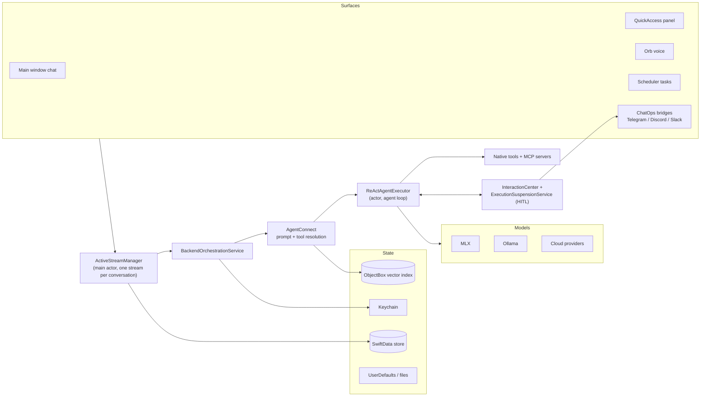

# Devgentic — Architecture

<!-- Drafted at commit cef4ece, 2026-09-29; revised the same commit after the M02/M03/M06/M11 module deep dives; A3 public-safety pass 2026-10-01 (all citations re-verified; admission wording corrected). Re-verify cited line numbers when revising. -->

A map of how Devgentic is put together, for a developer reading the code for the first time.
The [README](README.md) says what the app does; this document says how it is built and why.
Companion documents: [SECURITY.md](SECURITY.md) (trust model and reporting), [PRIVACY.md](PRIVACY.md)
(data handling), [CONTRIBUTING.md](CONTRIBUTING.md) (building and conventions).

---

## 1. What Devgentic is — and is not

Devgentic is a native macOS app for building and running AI agents. A user defines **backend
profiles** — a model bound to capabilities and settings — and runs them on different surfaces:
a chat window driven by a ReAct agent loop, a node-graph workflow canvas, a project-scoped
coding workspace, a global-hotkey panel, or a floating voice orb. Inference runs locally (MLX
on Apple Silicon, or a local Ollama server) or against a cloud provider; tools are a mix of
built-in macOS automation and anything a connected MCP server exposes.

What it deliberately is **not**:

- **Not sandboxed, and therefore not App Store–distributed.** The app exists to run shell
  commands, edit files, send Apple Events, and automate the UI on the user's machine, with the
  user's privileges. The App Sandbox is incompatible with that job, so the entitlements file
  carries only the four resource-access keys the features need — microphone, Apple Events,
  calendars/reminders, contacts — and none of the `com.apple.security.cs.*` hardening opt-outs
  (`Devgentic/Devgentic.entitlements`). Distribution is Developer ID–signed and notarized
  releases from the GitHub repository instead.
- **Not a service.** There is no backend of any kind. The app holds no account system, sends no
  telemetry, and every conversation, file and key stays on the Mac unless a profile's model
  provider is cloud-hosted — in which case sending the request to that provider is the feature
  (`PRIVACY.md`).
- **Not multi-user.** Where the app is driven remotely (ChatOps), it assumes one operator:
  the account that completed pairing. `SECURITY.md` states this trust model plainly.

## 2. Tech stack

| | |
|---|---|
| Language | Swift 5 language mode with `SWIFT_STRICT_CONCURRENCY = complete` (`Devgentic.xcodeproj/project.pbxproj:560-561`) |
| UI | SwiftUI, AppKit where SwiftUI does not reach (menus, panels, overlay scrollers) |
| Deployment target | macOS 26.1 (`project.pbxproj:456`); Apple Silicon required for the MLX backend |
| Persistence | SwiftData (primary store), ObjectBox (RAG vector index), GRDB (trace/log store), Keychain (secrets) |
| Local inference | [mlx-swift](https://github.com/ml-explore/mlx-swift) and [mlx-swift-lm](https://github.com/ml-explore/mlx-swift-lm); [WhisperKit](https://github.com/argmaxinc/WhisperKit) for dictation/transcription |
| Remote inference | Direct HTTPS to OpenAI, Anthropic, Google, OpenRouter, and any OpenAI-compatible endpoint |
| Agent protocol | [MCP swift-sdk](https://github.com/modelcontextprotocol/swift-sdk) for tool servers |
| Updates | [Sparkle](https://github.com/sparkle-project/Sparkle), EdDSA signatures |
| Other packages | GRDB.swift (SQLite), swift-markdown, CodeEditSourceEditor + Highlightr (code viewer), HotKey (global hotkeys), CoreXLSX / SwiftDocX (document readers), swift-transformers, flux-2-swift-mlx (image generation) |

Dependencies are resolved by Swift Package Manager from the Xcode project; the pinned set is
committed in `Package.resolved`, and licences are collected in
[THIRD_PARTY_NOTICES.md](THIRD_PARTY_NOTICES.md).

## 3. Repository layout

| Path | Contents |
|---|---|
| `Devgentic/` | The app target. |
| `Devgentic/Core/Backends/` | Per-provider LLM services and the generation stack. `TextGen/ReAct/` is the agent loop; `WorkflowGen/` is the workflow engine; `ImageGen/` is text-to-image. |
| `Devgentic/Core/Persistence/` | The SwiftData schema (`SwiftData/`), the RAG stack (`RAG/`), and provider-key stores. |
| `Devgentic/Core/Utils/` | Cross-cutting runtime services: stream orchestration (`ActiveStreamManager`), human-approval plumbing (`InteractionCenter`, `ExecutionSuspensionService`, `SessionToolApprovals`), history rendering (`EpisodicHistoryFormatter`), capability/risk metadata. |
| `Devgentic/Core/Service/` | Long-lived app services, e.g. the task scheduler (`Scheduler/SchedulerService.swift`). |
| `Devgentic/Core/Skills/` | The skills library: import, ingest, versioning, launch migration. |
| `Devgentic/Core/Storage/`, `Core/Types/`, `Core/Constants/`, `Core/Updates/` | Media storage, shared types and constants, Sparkle glue (`SoftwareUpdater.swift`). |
| `Devgentic/Interfaces/` | Every SwiftUI surface. `Main/` (main window, sidebar, profile editor, workflow canvas, tool library, MCP and settings), `Shared/` (chat timeline, composer, components), `Code/`, `QuickAccess/`, `Onboarding/`, `CommandPalette/`. The native tool implementations live under `Main/Views/Tooling/Local/`. |
| `Devgentic/ChatOps/` | The Telegram, Discord and Slack bridges: transports, pairing, authorization, command parsing, and the mirror that posts run state back to chat. |
| `Devgentic/Orb/` | The voice orb — self-contained wake-word/duplex audio surface. |
| `Devgentic/Intelligence/` | Routing and model-capability analysis (Morning Brief, personal profile). |
| `Devgentic/Observaliblity/` | Tracing and diagnostics. (The directory name is misspelled in the source tree; the code is consistent about it.) |
| `DevgenticTests/` | Unit tests (~650 files), including source-scanning "drift" tests that read production source and fail when invariants are violated. |
| `generated/` | Committed ObjectBox codegen output — see [README](README.md) for why there is no build phase for it. |
| `scripts/` | Release signing/verification scripts (see `CONTRIBUTING.md`). |
| `model-devgentic.json` | The ObjectBox entity model for the RAG store. |

## 4. Runtime overview

One idea: every surface — local or remote — funnels into the same stream orchestrator, which
runs a profile's model with a resolved tool set, and every durable thing it touches sits in one
of four stores.



## 5. Key flows

### 5.1 A chat turn through the agent loop

1. The composer (`Devgentic/Interfaces/Shared/ChatInput/`) hands the message to
   `MainApplicationViewModel`, which submits it to
   `ActiveStreamManager.startMessageStream` (`Devgentic/Core/Utils/ActiveStreamManager.swift:436`).
   One stream per conversation. A second *local* submit while one is running is queued, not
   dropped — it serialises behind the live run and the waiting state is visible on screen
   (`ConversationAdmission.swift`, "queue, never drop"); a second *ChatOps* turn is refused with
   an explanation instead, because a queued remote message would leave the operator waiting on an
   answer that cannot arrive.
2. The stream manager persists the user message, derives conversation history from the store
   (never from view state), and hands the turn to `BackendOrchestrationService`
   (`ActiveStreamManager.swift:705`), which resolves the profile's model into an `LLMProvider`
   and runs the prompt-fit check against the model's context window.
3. `AgentConnect` (`Devgentic/Core/Backends/TextGen/AgentConnect.swift`) builds the system
   prompt — instructions, episodic memory rendered by `EpisodicHistoryFormatter`
   (`Devgentic/Core/Utils/EpisodicHistoryFormatter.swift`), RAG context, skill manifests — and
   resolves the tool set: built-in tools from `NativeToolCatalog`
   (`Devgentic/Core/Backends/TextGen/NativeToolCatalog.swift`) plus `DynamicMCPTool` wrappers
   for connected MCP servers.
4. `ReActAgentExecutor` (`Devgentic/Core/Backends/TextGen/ReAct/ReActAgentExecutor.swift:22`)
   — an `actor` — runs the loop: request → parse the model's output with the parser for its
   dialect (`ReAct/Parsing/`) → execute requested tools → record observations → repeat until
   the model signals completion or the iteration cap (default 15, `ReActAgentExecutor.swift:35`).
   The loop carries the conversation on one of two substrates: providers with native tool calling
   get a growing, prefix-stable turn array; MLX and dialect models get the prompt rebuilt each
   iteration with run history carried as a working-memory scratchpad — both are bounded, compacted,
   and pressure-reported.
5. Each step is published as an `AgentStreamEvent` (`Devgentic/Core/Utils/AgentStreamEvent.swift`)
   on an `AsyncThrowingStream`; the stream manager writes messages to SwiftData as they arrive
   and updates the timeline.
6. The run ends with an honest verdict: a user denial or a skipped clarification is a choice, not
   a failure; a failure the agent retried to success is a blip; what remains turns `.completed`
   into `.completedWithWarnings`. Episodic memory stores degraded runs as failures, so a
   best-effort answer is never re-served later as a clean recipe for the task
   (`ReActAgentExecutor.swift:1625-1653`, `Devgentic/Core/Backends/TextGen/ReAct/Components/Memory/SessionGraph.swift:36-38`).

### 5.2 A tool call that needs approval (HITL)

1. Each tool carries a per-profile `requiresConfirmation` flag — set in the Tool Library
   (`Devgentic/Interfaces/Main/Views/Tooling/Local/utils/LocalToolManager.swift` feeds the UI) —
   and a risk label from `HITLRiskTier` (`Devgentic/Core/Utils/AgentStreamEvent.swift`).
   Whether the user is asked is exactly what the profile configured.
2. When a gated call is reached, `ActiveStreamManager.enqueueHITL`
   (`ActiveStreamManager.swift:1459`) parks the run through
   `ExecutionSuspensionService` (`Devgentic/Core/Utils/ExecutionSuspensionService.swift`) and
   posts a pending item to `InteractionCenter`
   (`Devgentic/Core/Utils/InteractionCenter.swift`), which is the single queue every surface
   reads.
3. The main window renders the pending call as a banner showing the tool, its resolved
   arguments, and its risk label. An "allow for this chat" choice is stored per-conversation —
   and per workflow node, since a grant in one node must not answer for another — by
   `SessionToolApprovals` (`Devgentic/Core/Utils/SessionToolApprovals.swift`), and is never
   served to an unattended run, which refuses the tool with an honest observation instead of
   parking for an answer nobody will give. A cancelled wait is never recorded as a denial.
4. The resolution resumes the suspension and the loop continues. A denial is recorded into
   episodic memory, so later turns know the user refused.
5. If the run is being mirrored to chat (5.3), the same pending item is posted there with
   buttons; whoever answers is carried on the resolution so every surface shows the true source —
   and a machine resolution (a Stop, a deadline) is never rendered as a person's decision.

### 5.3 A ChatOps message

1. Pairing is one-time and PIN-based: the user starts it in Settings, a six-digit PIN is
   generated on the Mac, and the first chat message carrying it binds that chat — and that
   sender's account — as the authorized operator. Guessing is rate-limited per origin by
   `PairingAttemptPolicy` (`Devgentic/ChatOps/Services/PairingAttemptPolicy.swift`).
2. Each platform has its own transport: Telegram polling
   (`ChatOps/Services/TelegramListener.swift`), Discord Gateway
   (`ChatOps/Services/DiscordGatewayClient.swift`), Slack Socket Mode
   (`ChatOps/Services/SlackSocketClient.swift`). Inbound messages are authorized by
   `ChatOpsSecurityGate` (`ChatOps/Services/ChatOpsSecurityGate.swift`) against the paired
   account, the bound channel, and the per-provider security tier (read-only → full access).
   The channel is an address; the paired account is the identity — in a shared channel, a
   bystander is refused in silence, because replying would confirm a Mac is listening. The one
   refusal that answers is rate-limiting the paired operator, who has already proved who they are.
3. An admitted free-text turn goes through `ChatOpsCommandService.submitTurn`
   (`ChatOps/Services/ChatOpsCommandService.swift`), which refuses if a run is already live in
   the conversation, requires the mirror to attach (`attachMirror` returns `Bool` — a run whose
   answer cannot get back is not started), and only then submits the message into the *same*
   stream path as a local turn, in its own conversation.
4. As the run progresses, the mirror renders state — replies, HITL prompts, plan reviews —
   through `RemoteView`/`RemoteRendering` into platform-shaped messages, strips credentials on
   the way out (`RemoteEgressSanitizer`), fits the result to the platform's message budget, and
   posts it via the platform API client. Mirroring is consented per run: only runs started from
   that chat are mirrored, and a run the mirror cannot attribute is refused rather than trusted.
5. Tool approvals and clarifications answered from chat resolve the same `InteractionCenter`
   items as a local click; `/cancel`, `/status` and similar verbs are parsed by
   `ChatOpsCommand` (`ChatOps/Models/ChatOpsCommand.swift`).

### 5.4 A workflow run

1. A workflow profile is a node graph authored on the canvas
   (`Devgentic/Interfaces/Main/Views/WorkflowCanvas/`); node layout is persisted by
   `WorkflowLayoutStore` (`Devgentic/Core/Persistence/SwiftData/WorkflowLayoutStore.swift`).
   Node kinds include profile nodes (an LLM step), routers, code transforms, Action nodes
   (tool calls), Gate nodes (a human decision mid-run), and triggers/actions.
2. A run starts from the canvas, a scheduled task, or a trigger. `WorkflowStreamProvider`
   (`Devgentic/Core/Backends/WorkflowGen/WorkflowStreamProvider.swift`) adapts the run to the
   same stream/event model as chat, and `WorkflowExecutor`
   (`Devgentic/Core/Backends/WorkflowGen/WorkflowExecutor.swift`) walks the graph, carrying
   variables between nodes in a `WorkflowExecutionContext`
   (`Devgentic/Core/Backends/WorkflowGen/WorkflowExecutionContext.swift`).
3. Action nodes run tools with the node's own tool configuration — including the approval
   check, which suspends through the same `ExecutionSuspensionService` as the agent path;
   Gate nodes pause the whole run until the user answers.
4. Run records land in `WorkflowRunHistoryStore`; a run still marked running at the next
   launch is reconciled to interrupted (`Devgentic/DevgenticApp.swift:129`).

## 6. Persistence map

| What | Where | How |
|---|---|---|
| Conversations, messages, profiles, prompts, scheduled tasks, skills registry, workflow layouts and run history, download history, MCP server config | One SwiftData store (`DevgenticSchema`, `Devgentic/Core/Persistence/SwiftData/DevgenticSchema.swift`) at `~/Library/Application Support/DevgenticSD.store` (`DevgenticSchema.swift:88`, `:158`). Schema versions and a migration plan are declared up front (`DevgenticSchemaVersions.swift`); opening the store is the app's first launch-critical step (`Devgentic/DevgenticApp.swift:28-44`). | SwiftData |
| RAG vector index (chunks, embeddings, parent documents) | An ObjectBox store under `Application Support/<bundle-id>/vector-db` (`Devgentic/Core/Persistence/RAG/VectorStoreService.swift`). Its generated code is committed under `generated/`, driven by `model-devgentic.json`. | ObjectBox |
| Trace/log records for observability | SQLite via GRDB (`Devgentic/Observaliblity/`), exportable in diagnostics bundles. | GRDB |
| API keys, bot tokens, OAuth tokens | Login Keychain only. Six stores implement the `KeychainAccessing` protocol: provider keys (`Devgentic/Interfaces/Shared/ChatInput/SecureKeyStorage.swift`), provider key shapes (`Devgentic/Core/Persistence/ProviderKeyStore.swift`), web-search keys (`Devgentic/Core/Persistence/WebSearchKeyStore.swift`), ChatOps credentials (`Devgentic/ChatOps/Models/ChatOpsConfig.swift`), MCP secrets (`Devgentic/Interfaces/Main/Views/Tooling/Mcp/MCPSecretStore.swift`), Hugging Face token (`Devgentic/Interfaces/Main/Views/BackendProfile/MlxLLM/HuggingFaceTokenStore.swift`). | Keychain |
| User preferences, per-provider settings, window state | `UserDefaults` | — |
| Attachments and generated images | Managed media files (`Devgentic/Core/Storage/MediaStore.swift`) | Files |
| Skills content | Files under the app's support directory, indexed by the SwiftData skill entities (`Devgentic/Core/Skills/`) | Files |

Deletions and recoveries are deliberately explicit: if the primary store will not open, the app
diagnoses the failure, tells the user where the data is, and offers a reversible "move aside" —
it never silently deletes (`DevgenticApp.swift:232-369`).

## 7. Security model

The trust model is **local**: the app runs unsandboxed with the user's privileges, on the
premise that the user is the authority over their own machine. `SECURITY.md` states what is and
is not considered a vulnerability under that model. The layers that make it defensible:

- **Per-tool consent.** Every tool's confirmation behaviour is configured per profile; a tool
  set to "ask" always asks, and destructive actions are split out of multiplexer tools so they
  can be gated individually.
- **HITL as the spine.** Approvals flow through one queue (`InteractionCenter`) and one
  suspension service, whether raised from chat, a workflow, or a remote bridge.
- **Argument hygiene.** Model-supplied values never become shell command strings (argv only),
  AppleScript values are escaped at a single choke point, and invoked programs receive `--`
  before model-supplied patterns so they cannot be read as flags. The git and search tools
  additionally neutralize config-driven code execution (`Devgentic/Interfaces/Main/Views/Tooling/Local/`,
  see `GitCommandBuilder` and the search tools' argv construction).
- **A declarative safety policy.** `Devgentic/SafetyPolicy.json` defines regex rules — blocked
  and confirm-required patterns for destructive shell usage — loaded by
  `Devgentic/Core/Utils/SecurityTools.swift`.
- **Secrets stay in the Keychain** (see the persistence map); no key material is stored in
  SwiftData, defaults, or files.
- **Egress control for ChatOps.** Everything posted to a third-party chat service passes a
  credential-stripping floor (`Devgentic/ChatOps/Services/RemoteEgressSanitizer.swift`), and
  authorization binds one paired account, never just a channel.
- **Hardened runtime + Developer ID signing** on release builds, with notarized, Sparkle-EdDSA-
  verified updates (`SUFeedURL` and `SUPublicEDKey` in `Devgentic/Info.plist:65-67`; the update
  flow lives in `Devgentic/Core/Updates/SoftwareUpdater.swift`). The release pipeline verifies
  the signature of the exported app before notarization (`CONTRIBUTING.md`).

## 8. Concurrency model

- The build compiles with `SWIFT_STRICT_CONCURRENCY = complete` in Swift 5 language mode, so
  actor isolation and `Sendable` are checked everywhere even though the codebase predates
  Swift 6 mode.
- **UI and orchestration are main-actor.** View models and the stream orchestrator are
  `@MainActor @Observable` (`ActiveStreamManager.swift:41-42`), so timeline state has one owner.
- **The agent loop is an actor.** `ReActAgentExecutor` runs iterations off the main actor and
  reports back over `AsyncThrowingStream<AgentStreamEvent>` (`ReActAgentExecutor.swift:47`).
- **Long-lived recorders are plain actors** (`LogRecorder`, `TraceRecorder` in
  `Devgentic/Observaliblity/`), kept independent of the main actor so a fatal-shutdown flush
  cannot be starved by the UI (`DevgenticApp.swift:590-591`).
- **Streams are conversation-scoped and single.** `ActiveStreamManager` keeps one live stream
  per conversation: a second local submit is queued, not dropped, and the waiting run says so on
  screen; a second ChatOps turn is refused while a run is live (§5.3). Runs never overlap in one
  conversation, and the stream persists incrementally so a crash or Stop leaves a consistent
  transcript. History for each turn is *derived* from the store rather than accepted from the
  calling surface.
- **Time limits bound compute, not wall clock.** A run parks indefinitely on a human decision
  with no watchdog of its own — the surrounding container (a workflow node's timeout, a
  schedule's limit) owns any deadline — and parked time is credited back to the owner chain, so
  a run that waited an hour for an approval is not killed by a five-minute limit
  (`ParkScope`, `ExecutionBudget`, `ComputeTimeoutSentinel`, `DeadlineRace` in
  `Devgentic/Core/Utils/`). Inner limits are shortened to fit outer ones, so the inner fires
  first and delivers its partial output.
- **Startup work is staged deliberately.** Non-critical bootstrap (skills sweep, download
  reconciliation, MCP server connections, scheduler arming) runs after the store opens, in a
  defined order, rather than blocking first paint (`DevgenticApp.swift:76-230`).

## 9. Building, testing, releasing

```bash
xcodebuild -project Devgentic.xcodeproj -scheme devgentic -destination 'platform=macOS' build
```

Tests use a two-phase `build-for-testing` / `test-without-building` split; parts of the suite
load real Whisper and embedding models, so target the classes you care about rather than
running everything (details and caveats in the [README](README.md)). Conventions that the build
enforces — including the file-header rule — are in
[CONTRIBUTING.md](CONTRIBUTING.md), which also covers the CLA, Developer ID signing, and the
release verification script.

## 10. Glossary

| Term | Meaning |
|---|---|
| **Backend profile** | The unit of configuration: a model + its provider settings, capabilities, tools, history strategy, and risk posture. Profiles are shared across surfaces — the same profile can be a chat agent, a workflow node, or the Orb. |
| **ReAct loop** | The agent execution model: the model reasons, calls tools, observes results, and repeats until it emits a final answer or hits the iteration cap (`ReActAgentExecutor`). |
| **HITL** | Human-in-the-loop: the approval gate that parks a run until a person approves, edits, or denies a tool call (or answers a workflow Gate node). |
| **Episodic memory** | The structured XML record of past turns and tool actions rendered into the system prompt each request, so the agent remembers what it did and what the user denied. |
| **Native tool** | A built-in macOS capability the model can call (filesystem, shell, git, AppleScript, EventKit, UI automation, …), declared in `NativeToolCatalog`. |
| **MCP** | Model Context Protocol: the standard for external tool servers. Connected servers contribute dynamic tools (`DynamicMCPTool`) and can request sampling or user input (elicitation). |
| **Skill** | A versioned instruction package in the skills library that a profile can load at runtime via the `load_skill` tool. |
| **Gate node** | A workflow node that pauses the run for a human decision before continuing. |
| **Park** | A run paused on a human decision (tool approval, clarification, plan review, gate). A park has no deadline of its own — the surrounding run, node or schedule owns any limit, and the waiting time is not counted against it. |
| **Mirror** | The ChatOps component that projects a run's state — replies, prompts, approvals — into a Telegram/Discord/Slack chat (`RemoteMirrorService`). |
| **Pairing** | The PIN-based handshake that binds one chat and one sender account to the Mac as the authorized ChatOps operator. |
| **Security tier** | The per-provider ChatOps permission level (read-only → standard → full access) that decides which remote verbs are available. |
| **RAG** | Retrieval-augmented generation: documents are chunked, embedded locally, and stored in the ObjectBox index; relevant chunks are injected into the prompt. |
| **Trace** | The observability record of a run — spans, tool calls, errors — stored via GRDB and viewable in the trends dashboard. |
